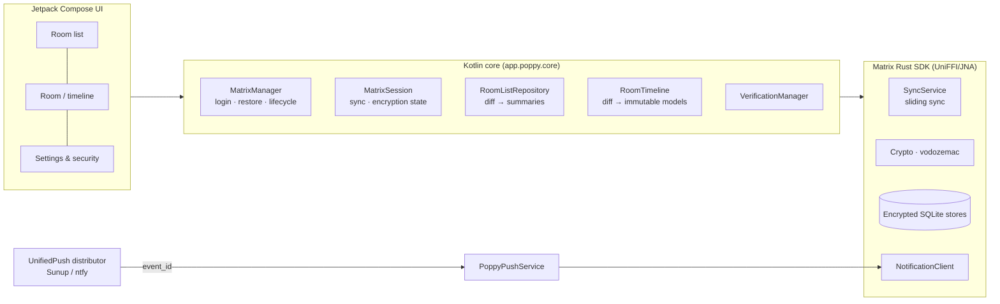

<div align="center">


# Poppy

**A native, fast and private [Matrix](https://matrix.org) client for Android.**

*Named after Poppy — a very good white & black Lakeland Terrier.* 🐾

[](https://github.com/sshahs/poppy/actions/workflows/android.yml)
[](https://github.com/sshahs/poppy/releases)
[](https://github.com/sshahs/poppy/releases)
[](LICENSE)
<br/>


<br/>

<a href="https://apps.obtainium.imranr.dev/redirect?r=obtainium://add/https://github.com/sshahs/poppy">
  
</a>
&nbsp;
<a href="https://github.com/sshahs/poppy/releases/latest">
  
</a>

</div>

---

## Why Poppy?

| | |
|---|---|
| ⚡ **Fast** | Sliding sync (MSC4186) with the battle-tested **Matrix Rust SDK** core, a lean Jetpack Compose UI, R8 full optimisation, per-ABI APKs and uncompressed, memory-mapped native libraries for quick cold starts. |
| 🔐 **Private** | End-to-end encryption by default, encrypted local stores (the SDK store cipher with a random per-account passphrase), session tokens sealed with an Android Keystore AES-256-GCM key, no analytics, no crash reporters, no Google Play Services. |
| 📱 **Native** | 100 % Kotlin + Material 3 Compose. Edge-to-edge, predictive back, Material You (optional), themed monochrome icon, conversation notifications with direct reply. |
| 🔔 **Push without Google** | [UnifiedPush](https://unifiedpush.org) via [ntfy](https://ntfy.sh), NextPush and friends, with a built-in end-to-end push test. No distributor? A battery-aware background-sync fallback kicks in. |

## Features

### ✅ Available now

**Accounts & security**
- Sign in with **OAuth 2.0 / OIDC (Matrix Authentication Service)**, **password**, or **SSO** — auto-detected per homeserver
- **End-to-end encryption** (Olm/Megolm via vodozemac) on by default for new DMs and private rooms
- **Interactive device verification** with emoji (SAS), both outgoing and incoming requests
- **Secure backup & recovery**: set up recovery, enter a recovery key/passphrase, rotate the key
- Automatic cross-signing bootstrap and key backup
- Session refresh tokens, soft-logout handling, encrypted on-disk session storage

**Chats**
- **Spaces**: switch between spaces from the chat list, browse a space's rooms and subspaces and join them
- Room list with **unread / mentions / people / rooms / favourites / invites** filters and fuzzy search
- Accept or decline **invites** inline; mark read/unread, favourite and leave from a long-press
- Timeline with **day dividers, unread marker, grouping, read ticks**, infinite back-pagination
- **Markdown** composer (`/me`, `/shrug`, `/plain`), **replies** (incl. swipe-to-reply), **edits**, **redactions**
- **Mentions**: `@` autocomplete for members and `@room`, intentional mentions, pills, and highlighted messages that mention you
- **Voice messages**: record (Opus/Ogg) with a live waveform, inline playback with seekable waveform
- **Reactions** (quick bar + emoji picker), **pinning**, copy/share/permalinks
- **HTML formatted messages** via a compact native renderer (lists, quotes, code, colours, spoilers), linkified plain text, emoji-only jumbo messages, inline timestamps
- **Images, stickers & GIFs** (animated), **video**, **audio**, **files**
- **Media captions** (add while sending, edit later) and **galleries / albums** (send several photos as one message)
- **Location**: send your current location or **share live location** for 15 min / 1 h / 8 h (Google-free, via Android's own location service)
- **Polls** — create, vote, live results, end
- **Attachments**: multi-select photo/video picker and document picker with a preview sheet, uploads stream from disk
- **Typing notifications**, read receipts (or private receipts), composer **drafts** that persist
- Full-screen pinch-zoom image viewer with **save to Downloads** and **share**
- **Share into Poppy** from any app; open **matrix.to** and **`matrix:`** links

**Rooms & people**
- Start DMs by name or Matrix ID (re-uses existing DMs), create public/private rooms with optional address
- **Explore** public room directories on any server and join by alias/ID
- Room info: encryption, per-room **notification mode**, favourite, members (with roles), invite, rename, topic, copy link
- Member actions: message, remove, ban, ignore/unignore

**Notifications**
- UnifiedPush (Sunup, ntfy, …) with automatic **Matrix gateway discovery**
- **Encrypted** notifications decrypted on-device by the Rust SDK's notification client
- Android conversation notifications: avatars, grouping, **direct reply**, **mark as read**
- Polling fallback via `JobScheduler` when no distributor is installed
- Global defaults for groups/DMs, mention & invite rules

**Look & feel**
- Light / dark / system, optional **Material You**, **pure black** OLED mode
- Themed (monochrome) launcher icon, adaptive icon, Poppy-red accent

### 🛠️ On the roadmap

Matrix is a big protocol and Poppy is young. Planned next, roughly in order:

- [ ] Threads view (thread summaries are shown today)
- [ ] Voice/video calls (Element Call / MatrixRTC)
- [ ] Message search (the Rust SDK search index)
- [ ] Device management list & sign out other sessions
- [ ] Map previews for locations, rich text editor
- [ ] Multi-account switching (storage already supports several accounts)
- [ ] Translations

Contributions are very welcome!

## 🔔 Push notifications

Poppy never talks to Google. Instead it uses **UnifiedPush**, an open standard where *you* pick the app that holds the push connection:

1. Install a distributor, e.g. **[ntfy](https://ntfy.sh)** (self-hostable) or NextPush. More at [unifiedpush.org](https://unifiedpush.org/users/distributors/).
2. In Poppy open **Settings → Notifications**, select it, and tap **Send test notification** to check the whole path end-to-end.
3. Poppy registers the endpoint with your homeserver through a Matrix push gateway — your distributor's own, if it provides one, otherwise `matrix.gateway.unifiedpush.org`.

> **Sunup and other Web Push–only distributors don't work with Matrix yet.** They sit on Mozilla's push service, which only accepts encrypted, VAPID-signed Web Push. Matrix homeservers currently send plain JSON through the gateway, so the push service rejects it. This needs homeserver support for Web Push pushers ([MSC4174](https://github.com/matrix-org/matrix-spec-proposals/pull/4174)). Poppy detects this and warns you; use ntfy, or enable background polling as a fallback.

Pushes only carry `event_id_only` payloads; message content is fetched and **decrypted on your device**.

No distributor installed? Turn on **Background polling** on the same screen: Android will wake Poppy roughly every 15 minutes (respecting Doze) for a short sync.

## 📦 Which APK should I install?

Each release ships one APK per CPU architecture plus a universal fallback:

| File | Devices |
|---|---|
| `poppy-<version>-arm64-v8a.apk` | **Almost every phone from the last ~8 years** — pick this if unsure |
| `poppy-<version>-armeabi-v7a.apk` | Older / low-end 32-bit phones |
| `poppy-<version>-x86_64.apk` | Emulators, Chromebooks, some tablets |
| `poppy-<version>-universal.apk` | Everything (much larger) |

**Obtainium**: tap the badge above. When asked which APK to track, choose `arm64-v8a` (or set *APK filter* to `arm64-v8a`). Obtainium also works with the Gitea releases of this repo (use the *Forgejo / Codeberg* source type with your Gitea URL).

Releases are signed with the same key every time, so in-place updates just work. SHA-256 checksums are attached as `SHA256SUMS.txt`.

## 🏗️ Architecture



Design choices that keep Poppy quick:

- **Diff-driven lists.** The Rust SDK emits `VectorDiff`s; Poppy applies them on a background dispatcher and only re-summarises rooms/events that changed, then publishes immutable snapshots that Compose can skip.
- **No DI framework, no reflection, no serialisation step** for navigation — a tiny hand-written graph and back stack.
- **Coil 3** with a custom fetcher for `mxc://` media (decryption handled by the SDK, which also caches).
- **Sync lifecycle tied to process foreground**, with a short linger to keep sliding-sync connections warm across quick app switches.
- **R8 full mode**, resource shrinking, single locale, per-ABI splits, page-aligned uncompressed `.so` files, `profileinstaller` for library baseline profiles.

```
app/src/main/kotlin/app/poppy
├── PoppyApp.kt            # Application + AppGraph (manual DI) + image loader
├── core/                  # Matrix sessions, room list, timeline, verification, media
├── push/                  # UnifiedPush service, notification renderer, polling job
├── ui/                    # Compose screens (login, rooms, room, details, settings, media)
└── util/                  # Small helpers (files, permalinks, formatting)
```

## 🧑‍💻 Building

Requirements: **JDK 17+** (CI uses 21) and the **Android SDK** with platform 37.

```bash
git clone https://github.com/sshahs/poppy.git
```

```bash
cd poppy
```

```bash
./gradlew assembleDebug
```

```bash
./gradlew testDebugUnitTest assembleRelease
```

Release APKs land in `app/build/outputs/apk/release/`. Without signing variables they are signed with your local debug key.

To sign locally, export:

| Variable | Meaning |
|---|---|
| `POPPY_KEYSTORE_PATH` | Path to your `.jks` keystore |
| `POPPY_KEYSTORE_PASSWORD` | Keystore password |
| `POPPY_KEY_ALIAS` | Key alias |
| `POPPY_KEY_PASSWORD` | Key password |
| `POPPY_VERSION_NAME` / `POPPY_VERSION_CODE` | Optional version override |

## 🚀 Releasing

Releases are cut by pushing a tag like `v0.1.0` (or `v0.2.0-beta.1` for a pre-release). `scripts/ci-version.sh` turns the tag into `versionName`/`versionCode`; each ABI gets its own `versionCode` suffix.

### 1. Create a signing key (once)

```bash
keytool -genkeypair -v -keystore poppy-release.jks -alias poppy -keyalg RSA -keysize 4096 -validity 36500
```

```bash
base64 -w0 poppy-release.jks > poppy-release.jks.b64
```

Keep the keystore safe — **losing it means users can't update in place**. Add these repository secrets:

| Secret | Value |
|---|---|
| `POPPY_KEYSTORE_BASE64` | Contents of `poppy-release.jks.b64` |
| `POPPY_KEYSTORE_PASSWORD` | Keystore password |
| `POPPY_KEY_ALIAS` | `poppy` |
| `POPPY_KEY_PASSWORD` | Key password |

Tag builds fail on purpose if the keystore secret is missing, so a debug-signed build can never be published.

### 2a. GitHub

`.github/workflows/android.yml` builds and tests every push and PR, uploads APKs as artifacts, and on `v*` tags publishes a GitHub Release with all APKs and checksums.

```bash
git tag v0.1.0
```

```bash
git push origin v0.1.0
```

No terminal handy? Open **Actions → Android → Run workflow**, enter a version such as `0.2.0`, and the workflow builds, signs, creates the `v0.2.0` tag and publishes the release for you.

### 2b. Gitea

`.gitea/workflows/android.yml` does the same on a Gitea instance:

- builds and tests on every push to `main` and uploads the APKs as workflow artifacts;
- on `v*` tags **publishes** the APKs to the Gitea **generic package registry** (`/api/packages/<owner>/generic/poppy/<version>/`) and creates a **Gitea release** with the APKs attached.

To enable it:

1. Mirror or push this repository to your Gitea instance.
2. Enable **Actions** for the repository and register an [act_runner](https://docs.gitea.com/usage/actions/act-runner) with the `ubuntu-latest` label (the default `catthehacker` images work).
3. Add the four signing secrets above under *Repository → Settings → Actions → Secrets*.
4. Optionally add `RELEASE_TOKEN` — a personal access token with `write:repository` and `write:package` scope. Without it the automatic job token is used.
5. Push a `v*` tag.

The workflow pulls actions by full GitHub URL, so it works whatever your instance's `DEFAULT_ACTIONS_URL` is. The runner needs outbound access to GitHub, Maven Central and Google Maven.

## 🔒 Privacy

- No analytics, telemetry or crash reporting of any kind.
- No Google Play Services / Firebase.
- Session tokens and store keys are encrypted with a hardware-backed Android Keystore key; Android backups are disabled for app data.
- The only servers Poppy talks to are your homeserver (and the servers it federates media from), your UnifiedPush distributor's push gateway, and identity/auth servers you sign in with.

## 🙏 Credits

- [Matrix Rust SDK](https://github.com/matrix-org/matrix-rust-sdk) & its [Kotlin bindings](https://github.com/matrix-org/matrix-rust-components-kotlin) — the heavy lifting for sync and crypto.
- [UnifiedPush](https://unifiedpush.org) for Google-free push.
- [Coil](https://coil-kt.github.io/coil/) for image loading.
- And Poppy, for supervising. 🐶

## 📄 License

Poppy is released under the [Apache License 2.0](LICENSE).
